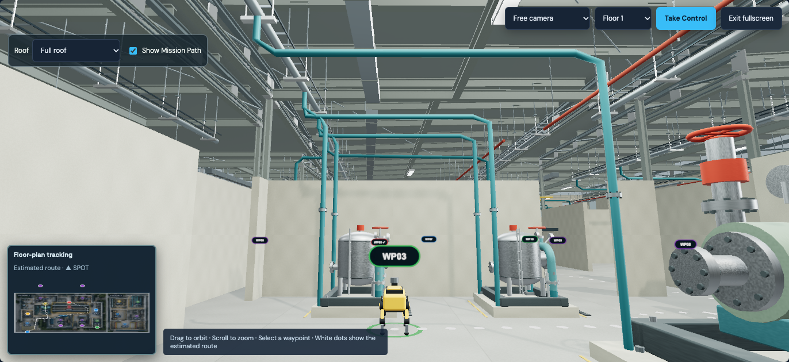
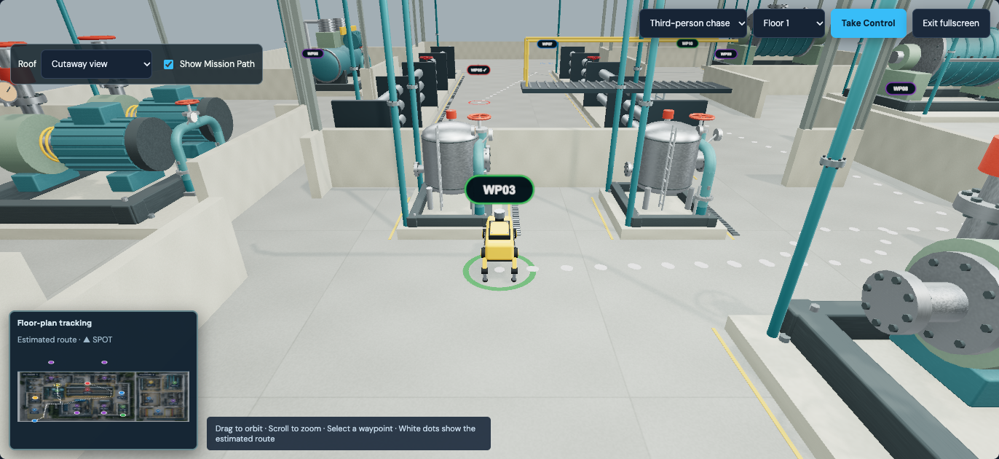

# SPOT industrial reference pass

Implemented directly in the local application, available at **http://localhost:3000**. Open **Mission Replay** for the default 75-second demo; use **Free camera + Full roof** to inspect ceiling infrastructure, or **Cutaway** to inspect machinery and routes. Blender is connected. The new assembly was generated and inspected there, and the original equipment scene was restored.

The supplied screenshot predates the existing roof controls, static guide and compressed demo. This pass improves the newer local build while retaining those features. The fictional floor-plan registration, room coordinates, all 15 waypoints and navigation footprints remain authoritative.

## Walls, structure and materials

The earlier rendering diagnosis found coplanar lower trim, intersecting independent wall boxes, duplicate procedural/imported columns, a zero-thickness floor and incorrectly scaled world-coordinate UV repeats. The retained fix unions wall footprints before generating surfaces, removes internal intersection faces, uses nonoverlapping caps and outward normals, and joins walls to a 0.2 m slab with their bases embedded 0.035 m. Camera depth planes remain 0.18–180 m. See [the preceding implementation report](static-demo-upgrade.md) for the complete diagnosis and original before/after captures.

This pass adds physical clerestory openings rather than placing window-colored polygons on solid walls. The window band subtracts apertures from the exterior wall footprint and emits their reveal faces. Glazing and frames fit inside those apertures. Exterior metadata changes wall rendering and camera obstruction heights without changing navigation rectangles. Painted wall surfaces use restrained concrete variation without floor-tile joints; the epoxy-like floor retains metre-scaled joints and a weaker micro-normal effect.

Columns and beams now use a closed I-section extrusion. This avoids overlapping web/flange caps and keeps each beam's deep axis vertical. The machinery fit starts at the foundation top, 0.22 m, and bolt heads remain visible above it.

## Ceiling and equipment integration

`facility-roof.mjs` provides one support plan for **15 bays, 55 columns and 80 purlins**. The former overlapping purlin grids were replaced with this shared plan. Column feet fit completely inside registered wall rectangles. Bay beams and trusses use those column endpoints; duplicate identical spans are omitted. Roof decking follows the original floor polygons at 7.4 m, with ribs clipped to their outlines. Services, hanger rods, duct supports and sprinkler hangers use points on those same purlin spans. Trapeze anchor bars connect paired rods to their supporting beams.

Cable trays have side rails and open cross-rungs. Ducts have seams and suspension rods. Separate process headers and red fire mains run at organized elevations. Sealed Blender luminaires retain their mounting rods and fixture beams. Full, Hidden, Cutaway and Overhead roof modes remain available; top-down navigation automatically hides overhead obstructions. Fixture lighting stays active through visibility changes.

Rounded service risers now terminate on actual bay headers; electrical conduits terminate at cable-tray runs. Flange rings and hex bolts mark riser joints. A new Blender manifold is installed on eight existing pump, compressor, exchanger, vessel and turbine foundations. Its ports connect down into the foundation as illustrative buried services. Assemblies and connector cylinders are instanced by floor/material. No new ground obstruction is introduced into mission corridors. Flush drainage grates are walkable and sit below the white route dots.

Waypoint sprites now sit at 1.4 m with a smaller distance-based size. Zone colors, waypoint picking, inspection status and recorded evidence remain available. Free-camera inspection can look upward, and obstruction handling keeps both its initial position and subsequent orbit positions outside intervening walls and equipment. Camera transitions, follow, first-person, overhead, floor switching and fullscreen remain functional.

## Blender assets

The new original asset in this pass is `public/models/services/service_manifold.glb`: **1,912 triangles, four material meshes, 86,468 bytes**, with no external textures. It includes two swept elbows, a header, bolted flanges, stanchions, feet, a bonnet, handwheel and mechanical dial. The dial has scale marks without an invented sensor value. Editable source: [spot-service-manifold.blend](../art/spot-service-manifold.blend); repeatable generator: [build-service-manifold.py](../scripts/build-service-manifold.py).

The preceding additions remain in use:

| Model | Triangles | Bytes |
| --- | ---: | ---: |
| Compressor | 7,664 | See engineered manifest |
| Heat exchanger | 6,248 | See engineered manifest |
| Roof truss | 908 | 60,856 |
| Industrial luminaire | 128 | 12,084 |
| Pipe hanger | 92 | 8,328 |

Their editable sources are `art/spot-facility-expansion.blend` and `art/spot-structure.blend`. Runtime loading now covers **15 GLBs**: seven engineered, four existing industrial and three structural assets plus the new manifold. Original project models use the project license; supplied industrial libraries retain their existing attribution.

## Fixed route and compressed playback

The recorded mission route remains independent of the live robot pose and active clock. Obstacle-aware routing runs when mission route data is loaded; `static-mission-path.js` uploads two floor-specific instanced dot buffers once. Small opaque white dots remain at the same coordinates, sizes and spacing ahead of and behind SPOT. Floor selection and **Show Mission Path** change visibility only. Replay frames, pause/resume, speed changes, scrubbing, camera changes and manual movement never rewrite the dot matrices. Selecting another mission replaces the guide with that mission's route. The minimap also retains its cached route coordinates and SVG nodes.

Manual takeover pauses progress and preserves collisions. Resume computes one separate recovery route, traverses it from the actual manual pose and then rejoins playback; it never overwrites the white guide. Unsupported inter-floor walking connections remain explicitly identified.

Demo playback still allocates more time to inspections and findings and less to travel/idle intervals, normalized to **75 seconds at 1×**. A reversible source/demo clock preserves original timestamps, evidence order and waypoint status without modifying the dataset. Recorded timing and the 1.5 m/s estimated walking mode remain selectable. Speeds 1×, 2×, 4× and 8×, restart, pause/resume, seek and ±10-second controls remain available. The gait cap prevents exaggerated leg animation at accelerated speeds.

## References and licenses

Inspected the user-provided [power-station interiors category](https://commons.wikimedia.org/wiki/Category:Interiors_of_power_stations), including the [Manapouri power station interior](https://commons.wikimedia.org/wiki/File:00_1393_New_Zealand_-_Manapouri_Power_Station.jpg): **W. Bulach**, photographed March 8, 2009, [CC BY-SA 4.0](https://creativecommons.org/licenses/by-sa/4.0/). Its pale structural steel, exposed supported services, concrete foundations, floor joints and drainage details guided this pass. The preceding [Walchensee turbine-hall reference](https://commons.wikimedia.org/wiki/File:Central_hidroel%C3%A9ctrica_de_Walchensee,_Kochel,_Baviera,_Alemania,_2014-03-22,_DD_04.JPG), **Diego Delso**, March 22, 2014, [CC BY-SA 3.0](https://creativecommons.org/licenses/by-sa/3.0/), informed enamel machinery and maintenance details. These photographs are visual references only; neither is redistributed as an application texture or used to replace the fictional layout.

## Before and after

These matched before/after captures compare the local build immediately before and after this pass:

| View | Before | After |
| --- | --- | --- |
| Facility overview | [Before](screenshots/reference-before-overview.png) | [After](screenshots/reference-after-overview.png) |
| Pipe-gallery walls | [Before](screenshots/reference-before-walls.png) | [After](screenshots/reference-after-walls.png) |

Additional final captures: [full-roof ceiling](screenshots/reference-after-ceiling.png), [cooling-loop equipment](screenshots/reference-after-equipment.png), [Floor 2 full roof](screenshots/reference-after-floor2.png). Roof-mode captures from the acceptance run: [full](screenshots/roof-full.png), [hidden](screenshots/roof-hidden.png), [cutaway](screenshots/roof-cutaway.png), [overhead](screenshots/roof-overhead.png).

## Validation and performance

Validated October 10, 2026 using Node 22 and local Chrome:

- **33 automated tests passed**, covering original dataset/analytics, registered layout, all same-floor waypoint pairs and collision-safe route interiors, timing/evidence, manual recovery, immutable dot buffers, wall normals, column feet, window openings, deck outlines, I-section geometry and manifold budgets/placement. The seven directly affected geometry/equipment tests were rerun after synchronizing foundation placement metadata and passed.
- **Production build passed** and `git diff --check` was clean. The existing Vite large-bundle warning remains.
- **Complete browser acceptance passed**: 15 successful model loads; all four speeds, clock modes, camera/roof modes, floor changes, fullscreen, scrubbing, static-path visibility, mission replacement, manual control/rejoin, 15 waypoint buttons, recorded anomaly evidence and mobile overflow. No page errors or unavailable-model warnings. Dot identity, matrix version/hash, color and opacity remained unchanged through the tested controls.
- **Measured M006 demo: 75.007 seconds of wall time at 1×**, averaging **60.01 FPS** on **Chrome ANGLE Metal / Apple M3 Pro**, browser viewport **1450 × 1050**. Average CPU render submission: **1.98 ms**. Final sampled counters: **542 draw calls and 494,385 submitted triangles**, counting enabled composer/shadow passes; these are not unique geometry counts or GPU timer measurements. Raw results: [browser-static-demo-results.json](browser-static-demo-results.json).
- **Focused camera regression passed after the camera clearance change**, checking Full-roof Free camera and orbit positions on both floors, camera mode switches and unchanged static guide buffers, with no page errors. Results: [browser-camera-clearance-results.json](browser-camera-clearance-results.json). Final full-roof captures were also inspected visually. The renderer/scene measured above is unchanged by the subsequent free-camera-only clearance adjustment.

Browser scripts use an external Playwright installation rather than adding an application dependency. Run `scripts/check-static-demo.cjs` for full acceptance, `scripts/check-camera-clearance.cjs` for camera clearance, and `scripts/capture-facility.cjs` with `SPOT_DETAIL=1` for full-roof/detail captures. Set `SPOT_PLAYWRIGHT_MODULE` to that installation's path. Hardware performance is device-specific; no matched before-performance benchmark was collected.

## Modified files and limits

This pass changes `src/facility-layout.mjs`, `src/facility-structure.mjs`, `src/facility-roof.mjs`, `src/steel-section.js`, `src/service-connections.mjs`, `src/replay-environment.js`, `src/plant-surfaces.js`, `src/engineered-assets.mjs`, `src/mission-markers.js` and `src/SpotReplayScene.jsx`. It adds the manifold generator, GLB, manifest and editable Blender library; adds `tests/facility-roof.test.mjs` and the camera check; updates equipment tests and browser asset counts/capture scripts; and updates README/reports/screenshots. The earlier static-route and demo changes are listed in [static-demo-upgrade.md](static-demo-upgrade.md).

Dimensions, ceiling engineering and service routing remain estimates because the floor-plan image does not specify construction or plumbing. This is an interactive reconstruction rather than a surveyed or photoreal twin. The source contains no inter-floor connector, so continuous walking between floors remains unavailable. Compressed demo travel can exceed real SPOT speed; normal estimated walking remains available. Performance on other hardware has not been measured. Real robot control and live sensor telemetry are not enabled by these changes.
