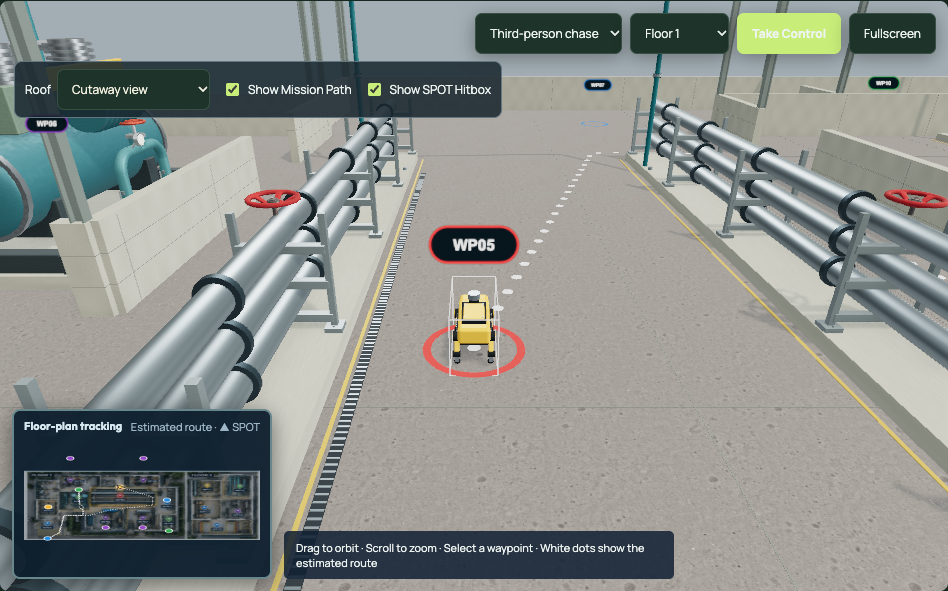

# SPOT geometry and collision improvements

Implemented in the existing simulator at **http://localhost:3000**. Open **Mission Replay** or **Mapping**. **Show SPOT Hitbox** is enabled by default; it toggles the white translucent outline without changing collision behavior or rebuilding the scene. Rooms and all 15 waypoint coordinates remain registered to the existing floor plan.

## Collision and robot scale

The [official SPOT specification](https://bostondynamics.com/wp-content/uploads/2020/10/spot-specifications.pdf), dated May 22, 2024 at the supplied URL, lists a robot length of 1.10 m, width of 0.50 m, default walking height of 0.61 m, and maximum speed of 1.6 m/s. The visual rig is calibrated against bounds measured over forward and reverse gait cycles. The separate collision root uses **1.15 × 0.55 m**, adding 25 mm on each side, and a 0.73 m vertical envelope accommodating the illustrative payload. The allowance is a simulation choice.

`spot-collision.mjs` checks the rotating rectangle against obstacle rectangles with a separating-axis test. Conservative swept checks cover both translation and rotation, including thin walls and concave floor boundaries. Manual motion uses that footprint directly, replacing the former fixed 0.65 m margin in both axes. The visible outline takes its dimensions from the same constants and inherits the same position and rotation.

Recorded routing keeps its rotation-safe planner for ordinary corridors. A validated straight footprint path or heading-aware fallback handles narrower openings; fallback paths include safe turns and preserve exact off-grid endpoints. Rotation segments receive traversal time rather than being skipped. These searches run when routes load or manual recovery starts, never in replay frames. Manual speed and gait speed are capped at 1.6 m/s; compressed demo travel retains its presentation timing.

## Geometry and industrial arrangement

- Replaced solid black pipe-gallery support panels with **14 open, bolted Blender racks**. Feet start at the 0.22 m foundation top, and crossbeams touch the undersides of the three pipe courses. Coupling rings avoid rack positions.
- Moved the floating pipe-gallery platform onto an existing pipe-bank foundation, added bearing posts, and moved its ladder outside the pipes with an access gap in the rail. Its ground supports remain inside the registered equipment footprint.
- Corrected warehouse shelf/post origins and crate heights, battery shelf contacts, column footplates and valve-riser bases. Cargo no longer extends beyond rack foundations. Drain grilles now sit within 8 mm of the floor, below route dots.
- Added a standby process pump at WP04, a lubrication reservoir at WP08, a cooling pump at WP09, a circulation pump at WP12, and a second spare-parts rack at WP13. These use existing models at different sizes. Their foundations are registered as collision obstacles and all same-floor waypoint pairs remain reachable.
- Added two original Blender maintenance carts on the existing WP15 service pad. Every operational bay has a licensed electrical panel mounted to a room-facing wall, with conduit and brackets; selected bays have warning plaques. Wall-mounted details follow upper-wall visibility, so they do not float when the walls are cut away.
- Retained supported overhead services, ducts, trays, suspended fixtures and framing. Exterior walls now meet the roof deck at 7.4 m. Roof controls, internal partitions, floor selection and camera obstruction handling remain available.

The two new GLBs total **54,068 bytes**: the rack has 164 triangles and one material mesh; the cart has 600 triangles and four meshes. Their runtime placements are instanced by floor and mesh/material. Editable source: [spot-industrial-details.blend](../art/spot-industrial-details.blend). Generator: [build-industrial-details.py](../scripts/build-industrial-details.py). The preexisting Blender scenes were left intact.

## Materials and reference comparison

The floor now uses actual 1K diffuse, roughness and OpenGL normal maps from [Concrete Floor](https://polyhaven.com/a/concrete_floor), **eye-candy.xyz / Poly Haven, CC0**, at its documented 2.08 m scale. Shader desaturation removes the outdoor brown cast while preserving photographed wear. Expansion joints follow both axes and are clipped to each floor polygon. Wall seams follow the unioned wall surfaces, with restrained concrete variation and consistent thickness. Existing safety lines, drainage and bolted equipment foundations remain.

Inspected the supplied asset websites and engineering/case-study links, the existing GLBs and screenshots, and downloaded photographs/material samples. [Reference files and license notices](../references/README.md) document what is redistributed and what is used only as a reference. No unlicensed marketplace assets or Boston Dynamics photographs were packaged.

The [Manapouri photograph](../references/architecture/manapouri.jpg), W. Bulach / CC BY-SA 4.0, shows organized machinery foundations, clear inspection aisles, painted safety boundaries, floor joints and wall-side electrical services. These informed the floor and wall detailing and the placement of auxiliary systems beside their primary machines. The [Walchensee photograph](../references/architecture/walchensee.jpg), Diego Delso / CC BY-SA 3.0, informed enamel machinery, accessible maintenance areas and consistent structural bays. Its long open turbine hall is a visual reference; the simulator retains the supplied partitioned room layout. The alternate aggregate concrete and heavily rusted metal samples were inspected but not applied across the indoor plant.

Screenshot review caught an overly brown floor, coupling rings intersecting rack beams, a ladder crossing the pipe courses, and an oversized warehouse label when the chase camera was close to a wall. All four were corrected. Close waypoint labels now have a capped angular size while preserving distant labels and picking.

## Screenshots

Matched captures use the same mission, timestamps, floor and camera/roof selections:

| View | Before | After |
| --- | --- | --- |
| Both-floor overview | [Before](screenshots/collision-before-overview.png) | [After](screenshots/collision-after-overview.png) |
| Pipe-gallery supports / hitbox | [Before](screenshots/collision-before-walls.png) | [After](screenshots/collision-after-walls.png) |
| Cooling equipment | [Before](screenshots/collision-before-equipment.png) | [After](screenshots/collision-after-equipment.png) |
| Full-roof ceiling | [Before](screenshots/collision-before-ceiling.png) | [After](screenshots/collision-after-ceiling.png) |
| Floor 2 | [Before](screenshots/collision-before-floor2.png) | [After](screenshots/collision-after-floor2.png) |

All rooms were captured at their actual recorded inspection arrivals in normal dashboard view, with overhead and chase views. The five matched detail captures also exercise fullscreen. See [room inspection results](browser-industrial-rooms-results.json). Representative views: [standby pump](screenshots/collision-room-WP04-plan.png), [turbine auxiliary systems](screenshots/collision-room-WP08-plan.png), [exchanger circulation pump](screenshots/collision-room-WP12.png), [warehouse](screenshots/collision-room-WP13.png), and [maintenance carts](screenshots/collision-room-WP15.png). All remaining room captures use `collision-room-WP01` through `collision-room-WP15`, with `-plan` for overhead views.

## Verification

- **42 Node 22 tests passed**, including all same-floor waypoint pairs, source-data integrity, evidence/timing, fixed route buffers, geometry budgets, mounting envelopes and new footprint checks. The 0.65 m doorway passes in manual and automatic navigation; the 0.50 m opening blocks SPOT. Turning in a narrow corridor, swept corners, thin-wall tunneling, equipment collisions, overhead clearance, off-grid heading routes and complete forward/reverse gait bounds are checked.
- **Production build passed**; the existing Vite large-bundle warning remains. `git diff --check` passed.
- **Full Chrome acceptance passed:** all 17 GLBs loaded; hitbox default/toggle/identity and pose alignment; manual movement and one-plan recovery; replay modes, speeds, cameras, roof controls, floors, waypoint evidence, fullscreen and mobile overflow. Static dot buffer identities/hashes and minimap SVG nodes/coordinates stayed unchanged. [Raw browser results](browser-collision-upgrade-results.json).
- **M006 demo:** 75.024 seconds at 1×, averaging **60.01 FPS** on Chrome ANGLE Metal / Apple M3 Pro, viewport 1450 × 1050. Average CPU render submission was 1.51 ms. Final sampled counters were 296 draw calls and 302,321 submitted triangles. These include active rendering passes and are not unique mesh counts or GPU timings; optional AO remains adaptive. No blocked hitbox samples were observed in the full run. The later flange/ladder/drain and label refinements were checked separately in screenshots, builds and focused checks; no second performance claim is made for those minor refinements.
- **Both-floor camera regression passed** with full-roof free views and orbit clearance. [Results](browser-collision-camera-results.json). All 15 room arrivals had clear hitboxes, and Mapping hitbox toggles/mobile layout passed. The final warehouse label correction has [its own focused browser result](browser-warehouse-label-results.json).

Reproduce with `scripts/check-static-demo.cjs`, `scripts/check-camera-clearance.cjs`, `scripts/inspect-industrial-rooms.cjs`, and `scripts/capture-facility.cjs` (`SPOT_DETAIL=1`). Browser tools use the existing external Playwright installation through `SPOT_PLAYWRIGHT_MODULE`; room inspection needs Node 22.

Floor-plan dimensions and service routing remain estimated; the result is an interactive reconstruction. The source still provides no inter-floor stair/lift connection, so walking transfers are shown explicitly rather than invented. No real robot or live sensor connection was added.
